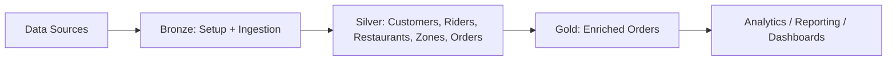

# HungryHop Food Delivery Analytics

<div align="center">
  
  
  
</div>

> Daily analytics pipeline for a food delivery ecosystem: customers, riders, restaurants, zones, and live order events.

## ✨ Overview

HungryHop is a Databricks-based data engineering and analytics project that follows the medallion architecture pattern:

- Bronze: raw ingestion and landing
- Silver: cleaning, validation, and standardization
- Gold: enriched order intelligence for reporting and insights

The pipeline is orchestrated as a Databricks bundle job and is structured for daily operational refreshes.

## 🌊 Data flow



## 🚀 Features

- Automated daily pipeline orchestration
- Bronze-to-Gold transformation flow
- Standardized customer, rider, restaurant, and zone reference data
- Clean order event processing for downstream analytics
- Databricks bundle deployment support
- Production/dev environment separation via catalog variables

## 🧱 Project structure

```text
Hungry_hop_food_deilvery/
├── databricks.yml
├── pyproject.toml
├── AGENTS.md
├── resources/
│   └── hop_daily.job.yml
├── src/
│   ├── Bronze/
│   │   ├── Setup.ipynb
│   │   └── Ingestion.ipynb
│   ├── Silver/
│   │   ├── customers_clean.py
│   │   ├── riders_clean.py
│   │   ├── zone_clean.py
│   │   ├── restaurants_clean.py
│   │   └── orders_event_clean.py
│   ├── Gold/
│   │   └── orders_enriched.py
│   └── ...
├── fixtures/
├── resources/
└── tests/
```

## 🏭 Pipeline components

### Bronze layer
- `src/Bronze/Setup.ipynb` — catalog/schema/volume bootstrapping
- `src/Bronze/Ingestion.ipynb` — raw data ingestion using Databricks workflow patterns

### Silver layer
- `customers_clean.py` — customer data cleaning and standardization
- `riders_clean.py` — rider profile cleanup and validation
- `zone_clean.py` — zone/geographic data processing
- `restaurants_clean.py` — restaurant reference data cleanup
- `orders_event_clean.py` — order event quality checks and transformation

### Gold layer
- `orders_enriched.py` — business-ready enriched order dataset for downstream insights

### Bundle orchestration
- `resources/hop_daily.job.yml` — daily job with task dependency flow
- `databricks.yml` — bundle config and catalog management

## 🛠️ Setup and deployment

### Prerequisites
- Databricks workspace access
- Python 3.12
- Databricks CLI configured for the workspace

### Deploy bundle

```bash
databricks auth login
databricks bundle deploy --target dev
```

### Run pipeline

```bash
databricks bundle run hop_daily --target dev
```

### Environment targets
- `dev` -> `hop_dev`
- `prod` -> `hop_prod`

## 📈 Business value

The project is designed to help teams answer questions like:

- Which restaurants perform best?
- How are riders delivering across zones?
- Which order patterns drive demand peaks?
- Where are the major data quality issues in order lifecycle events?

## 🧪 Tech stack

- Python 3.12
- PySpark
- Databricks notebooks
- Databricks jobs and bundles
- Delta / Lakehouse data model

## 📌 Notes

This repo follows a practical modern data engineering structure for food delivery analytics, with modular transformation tasks and an easy-to-extend architecture.

---

<p align="center">
  <strong>Built for smarter food delivery intelligence.</strong>
</p>
